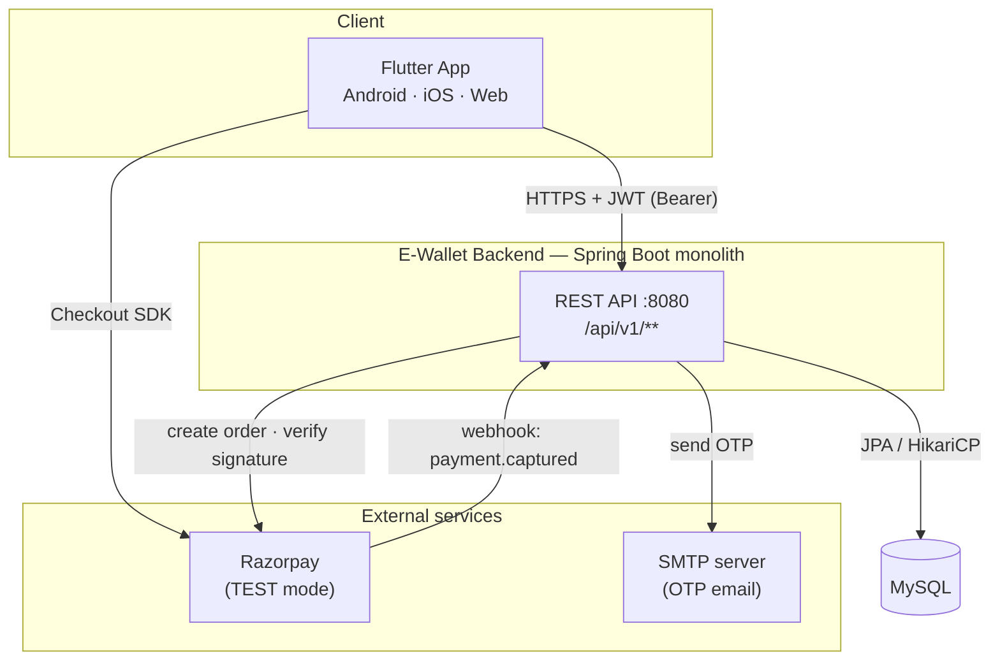
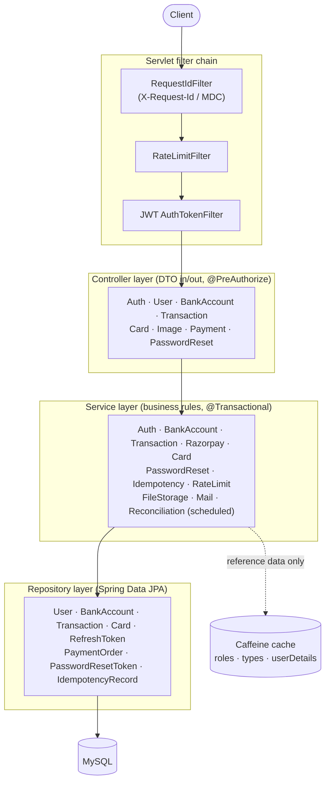
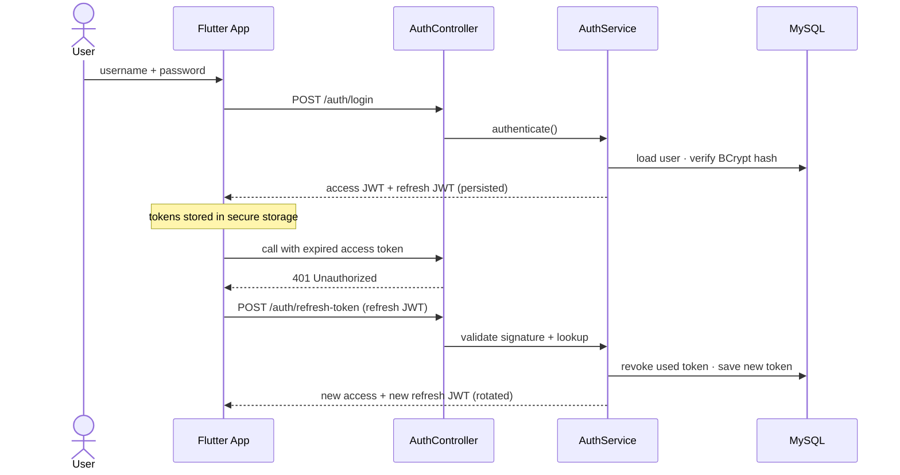
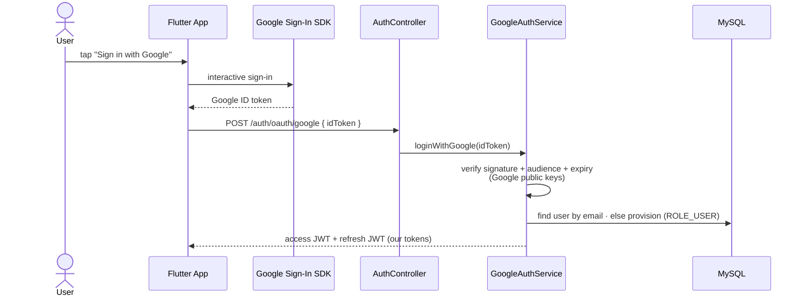
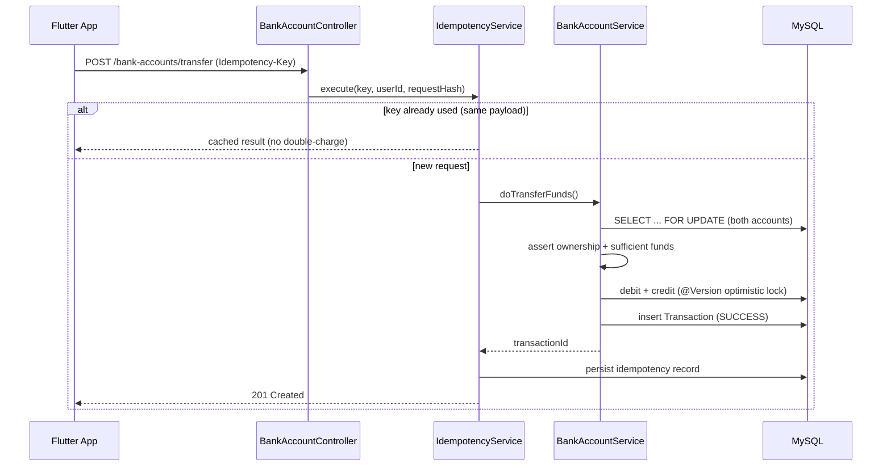
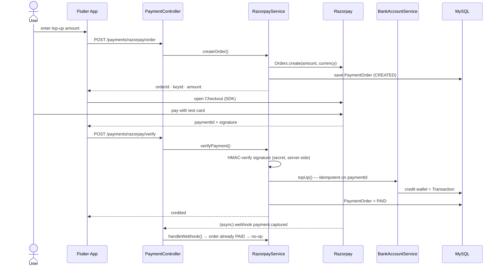
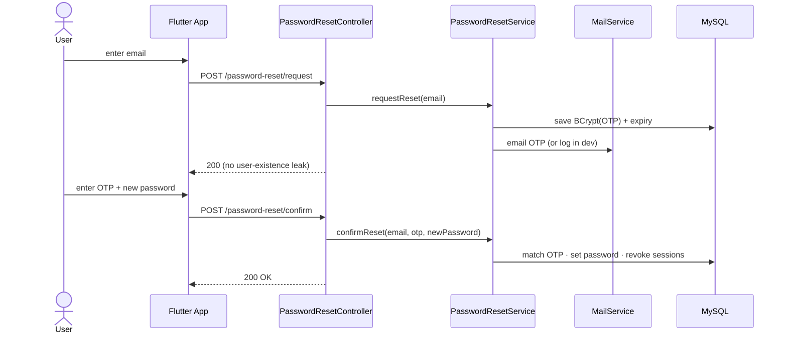

# E-Wallet Backend

REST API for a digital wallet platform. Users can register, manage bank accounts, and perform transfers, deposits, and withdrawals with JWT-based authentication.

Built with Spring Boot as a single deployable service — no microservices, no message brokers. The focus is on correct financial operations, clear layering, and patterns you'd actually use in a production monolith.

**Live demo:** [madhavchhabra.github.io/E-Wallet-Frontend](https://madhavchhabra.github.io/E-Wallet-Frontend/). Tap "Explore Live Demo" for a pre-filled account; Razorpay runs in test mode, so no real money moves. Flutter client: [E-Wallet-Frontend](https://github.com/MadhavChhabra/E-Wallet-Frontend).

## Tech Stack

| Layer | Technology |
|-------|------------|
| Runtime | Java 17 |
| Framework | Spring Boot 3.0 |
| Persistence | Spring Data JPA, MySQL |
| Security | Spring Security, JWT (JJWT) |
| Mapping | MapStruct |
| Validation | Jakarta Bean Validation |
| Cache | Caffeine (in-memory) |
| API Docs | SpringDoc OpenAPI |
| Testing | JUnit 5, Mockito, H2 |

## System Architecture

The application follows a **layered monolith** architecture. HTTP concerns stay in controllers; business rules live in services; data access is isolated in repositories.

```
Client (Web / Mobile)
        │
        ▼
┌───────────────────────────────────────────┐
│  Filters                                   │
│  RequestId → RateLimit → JWT Auth          │
└───────────────────────────────────────────┘
        │
        ▼
┌───────────────────────────────────────────┐
│  Controller Layer                          │
│  Auth · BankAccount · Transaction          │
│  (DTO in / out, validation)                │
└───────────────────────────────────────────┘
        │
        ▼
┌───────────────────────────────────────────┐
│  Service Layer                             │
│  Auth · BankAccount · Transaction          │
│  Idempotency · Reconciliation (scheduled)  │
└───────────────────────────────────────────┘
        │
        ▼
┌───────────────────────────────────────────┐
│  Repository Layer (Spring Data JPA)        │
└───────────────────────────────────────────┘
        │
        ▼
     MySQL
```

### Request flow (authenticated endpoint)

1. `RequestIdFilter` assigns or propagates `X-Request-Id` for log correlation.
2. `RateLimitFilter` throttles login attempts by IP.
3. `AuthTokenFilter` validates the JWT and loads the user into the security context.
4. Controller validates the request DTO and delegates to a service.
5. Service enforces **resource ownership** (users only access their own accounts).
6. For money operations: balance update and transaction record happen in a single `@Transactional` boundary.

### Core domain model

```
User ──< BankAccount
  │         │
  │         ├──< Transaction (from)
  │         └──< Transaction (to)
  └──< RefreshToken

Transaction → Type (Transfer, Deposit, Withdraw, etc.)
IdempotencyRecord (per-user duplicate request tracking)
```

## Architecture & Design (HLD / LLD)

### High-Level Design — system context



### Component architecture — layers & filter chain



### LLD — authentication & refresh-token rotation



### LLD — Sign in with Google



### LLD — fund transfer (idempotency + locking)



### LLD — Razorpay wallet top-up (verify + webhook)



### LLD — password reset via OTP



### Domain model (ER diagram)

```mermaid
erDiagram
    USER ||--o{ BANK_ACCOUNT : owns
    USER ||--o{ REFRESH_TOKEN : has
    USER ||--o{ CARD : saves
    USER ||--o{ PAYMENT_ORDER : initiates
    USER ||--o{ PASSWORD_RESET_TOKEN : requests
    USER }o--o{ ROLE : user_role
    BANK_ACCOUNT ||--o{ TRANSACTION : from
    BANK_ACCOUNT ||--o{ TRANSACTION : to
    TYPE ||--o{ TRANSACTION : classifies

    USER {
      bigint id PK
      string username UK
      string email UK
      string password
      string profileImageFilename
    }
    BANK_ACCOUNT {
      bigint id PK
      string iban UK
      decimal balance
      bigint version
    }
    TRANSACTION {
      bigint id PK
      decimal amount
      uuid referenceNumber UK
      string status
      string operationType
    }
    CARD {
      bigint id PK
      string last4
      string brand
      string token UK
    }
    PAYMENT_ORDER {
      bigint id PK
      string razorpayOrderId UK
      decimal amount
      string status
    }
    PASSWORD_RESET_TOKEN {
      bigint id PK
      string otpHash
      datetime expiresAt
      boolean consumed
    }
```

## Key Design Decisions

**Atomic wallet operations** — Transfers debit one account and credit another in one transaction. If anything fails, everything rolls back.

**Concurrency control** — Pessimistic write locks during balance updates, plus optimistic locking (`@Version`) on accounts to catch concurrent modifications.

**Idempotency** — Money endpoints accept an optional `Idempotency-Key` header so clients can safely retry without double-charging.

**Authorization beyond authentication** — JWT proves identity; services verify the authenticated user owns the account being accessed.

**Cache only reference data** — Transaction types, roles, and user details are cached. Account balances are never cached.

**Nightly reconciliation** — A scheduled job replays transactions and compares computed balances against stored values.

## Project Structure

```
src/main/java/com/ewallet/
├── common/          # Shared constants and messages
├── config/          # Security, cache, filters, OpenAPI
├── controller/    # REST endpoints
├── dto/             # Request/response objects and MapStruct mappers
├── exception/       # Custom exceptions and global handler
├── model/           # JPA entities
├── repository/      # Data access interfaces
├── security/        # JWT, filters, UserDetails
├── service/         # Business logic
└── validator/       # Custom validation (IBAN)
```

## API Overview

Base URL: `http://localhost:8080`

| Method | Endpoint | Auth | Description |
|--------|----------|------|-------------|
| POST | `/api/v1/auth/signup` | No | Register user |
| POST | `/api/v1/auth/login` | No | Get access + refresh token |
| POST | `/api/v1/auth/refresh-token` | No | Refresh access token (rotates the refresh token) |
| POST | `/api/v1/auth/oauth/google` | No | Sign in with Google (verifies ID token, issues JWTs) |
| POST | `/api/v1/auth/demo` | No | One-click demo: provision a pre-populated account + tokens |
| POST | `/api/v1/auth/logout` | Yes | Revoke all refresh tokens for the user |
| POST | `/api/v1/auth/password-reset/request` | No | Email a one-time reset code |
| POST | `/api/v1/auth/password-reset/verify` | No | Verify an OTP without consuming it |
| POST | `/api/v1/auth/password-reset/confirm` | No | Set a new password using the OTP |
| GET | `/api/v1/bank-accounts` | Yes | List current user's accounts (paginated) |
| POST | `/api/v1/bank-accounts` | Yes | Create account |
| POST | `/api/v1/bank-accounts/transfer` | Yes | Transfer between accounts |
| POST | `/api/v1/bank-accounts/add-funds` | Yes | Deposit |
| POST | `/api/v1/bank-accounts/withdraw-funds` | Yes | Withdraw |
| GET | `/api/v1/transactions` | Yes | List current user's transactions |
| GET | `/api/v1/users/me` | Yes | Current user's profile |
| PUT | `/api/v1/users/me/profile-image` | Yes | Set profile image (by uploaded filename) |
| PUT | `/api/v1/users/me/change-password` | Yes | Change password (requires current password) |
| GET | `/api/v1/cards` | Yes | List saved cards (masked) |
| POST | `/api/v1/cards` | Yes | Save a card (tokenized; PAN/CVV never stored) |
| DELETE | `/api/v1/cards/{id}` | Yes | Delete a saved card |
| POST | `/api/v1/images` | Yes | Upload an image (multipart) |
| GET | `/api/v1/images/{filename}` | No | Fetch an image by opaque filename |
| POST | `/api/v1/payments/razorpay/order` | Yes | Create a Razorpay top-up order (TEST mode) |
| POST | `/api/v1/payments/razorpay/verify` | Yes | Verify payment signature and credit wallet |
| POST | `/api/v1/payments/razorpay/webhook` | No* | Authoritative credit via Razorpay webhook (*HMAC-verified) |
| GET | `/actuator/health` | No | Health check |

Interactive docs: [http://localhost:8080/swagger-ui.html](http://localhost:8080/swagger-ui.html)

### Razorpay top-up (TEST mode)

Wallet top-ups go through Razorpay in test mode — a real gateway flow with no real
money. The server creates the order and **verifies the payment signature with the
secret key server-side** before crediting the wallet. Crediting is idempotent on
the Razorpay payment id, so a duplicated callback cannot double-credit.

Two crediting paths, both idempotent:

1. **Client verify** (`/verify`) — instant UX right after the Checkout succeeds.
2. **Webhook** (`/webhook`, `payment.captured`) — the **authoritative** path. Even
   if the app dies before calling `/verify`, a captured payment still credits the
   wallet exactly once. The raw body is HMAC-verified against the webhook secret.

Enable it with environment variables (free test keys:
<https://dashboard.razorpay.com/app/keys>):

```
RAZORPAY_ENABLED=true
RAZORPAY_KEY_ID=rzp_test_xxxxxxxxxxxxxx
RAZORPAY_KEY_SECRET=your_test_secret        # server-side only
```

### Key environment variables

| Variable | Purpose |
|----------|---------|
| `SPRING_PROFILES_ACTIVE` | `dev` / `prod` / `test` |
| `DB_URL`, `DB_USERNAME`, `DB_PASSWORD` | Datasource (required in prod) |
| `APP_SECURITY_JWT_SECRET` | JWT signing secret (≥32 chars, required in prod) |
| `APP_SECURITY_REFRESH_TOKEN_SECRET` | Refresh-token signing secret (≥32 chars) |
| `APP_CORS_ALLOWED_ORIGINS` | Comma-separated allowed origins |
| `RAZORPAY_ENABLED`, `RAZORPAY_KEY_ID`, `RAZORPAY_KEY_SECRET` | Razorpay test integration |
| `GOOGLE_OAUTH_ENABLED`, `GOOGLE_CLIENT_ID` | Google Sign-In (client id may be comma-separated audiences) |
| `MAIL_ENABLED`, `MAIL_HOST`, `MAIL_PORT`, `MAIL_USERNAME`, `MAIL_PASSWORD`, `MAIL_FROM` | SMTP for OTP email |
| `APP_PASSWORD_RESET_EXPOSE_OTP` | Dev only: return the OTP in the API/log |
| `APP_STORAGE_TYPE` | `local` (default) or `s3` |
| `APP_STORAGE_LOCATION` | Directory for uploaded images (local mode) |
| `APP_STORAGE_S3_BUCKET`, `APP_STORAGE_S3_REGION` | S3 bucket + region (s3 mode; creds from the default AWS chain / EC2 role) |
| `DEMO_ENABLED` | Enable the one-click demo-account endpoint (default true) |

### One-click demo

`POST /api/v1/auth/demo` provisions a **fresh, isolated user** pre-populated with
two accounts (balances that reconcile) and a realistic transaction history, then
returns tokens — so a first-time visitor lands on a filled dashboard. Seeding runs
through the real transfer/deposit/withdraw services under a temporary security
context, so the data is authentic. Rate-limited per IP; disable with `DEMO_ENABLED=false`.

### Authentication

Send the access token on protected routes:

```
Authorization: Bearer <access_token>
```

For transfer, deposit, and withdraw, optionally include:

```
Idempotency-Key: <unique-uuid>
```

### Response format

Success:
```json
{
  "timestamp": 1717459200000,
  "message": "Success",
  "data": { }
}
```

Error:
```json
{
  "status": 400,
  "message": "Insufficient balance: amount exceeds the available account balance",
  "errorCode": "INSUFFICIENT_FUNDS"
}
```

## Getting Started

### Prerequisites

- Java 17+
- Maven 3.8+
- MySQL 8.x

### Database setup

```sql
CREATE DATABASE ewallet_new;
```

### Configuration

The app uses Spring profiles. For local development:

1. Copy the local config template:
   ```bash
   cp src/main/resources/application-local.properties.example \
      src/main/resources/application-local.properties
   ```

2. Set your MySQL credentials in `application-local.properties`:
   ```properties
   spring.datasource.username=your_user
   spring.datasource.password=your_password
   ```

This file is gitignored. JWT secrets for dev are provided in `application-dev.properties`.

| Profile | Purpose |
|---------|---------|
| `dev` | Local development (`ddl-auto=update`) |
| `prod` | Production (`ddl-auto=validate`, no SQL logging) |
| `test` | Unit/integration tests (H2 in-memory) |

### Run

```bash
./mvnw spring-boot:run
```

Or set active profile to `dev` in your IDE and run `EWalletApplication`.

### Test

```bash
./mvnw test
```

## Configuration Reference

| Property | Default | Description |
|----------|---------|-------------|
| `app.rate-limit.login.max-requests` | 10 | Login attempts per minute per IP |
| `app.rate-limit.transfer.max-requests` | 30 | Money ops per minute per user |
| `app.pagination.max-page-size` | 100 | Max page size on list endpoints |
| `app.reconciliation.cron` | `0 0 2 * * *` | Nightly balance check schedule |
| `app.cache.reference-data.ttl-minutes` | 60 | Cache TTL for roles/types |

## Error Codes

| Code | HTTP | Meaning |
|------|------|---------|
| `INSUFFICIENT_FUNDS` | 400 | Balance too low |
| `FORBIDDEN` | 403 | Accessing another user's resource |
| `NOT_FOUND` | 404 | Resource does not exist |
| `ALREADY_EXISTS` | 409 | Duplicate IBAN, username, etc. |
| `CONCURRENT_MODIFICATION` | 409 | Account modified during transfer |
| `IDEMPOTENCY_CONFLICT` | 422 | Same key, different payload |
| `RATE_LIMIT_EXCEEDED` | 429 | Too many requests |

## License

This project is for educational and portfolio use.
